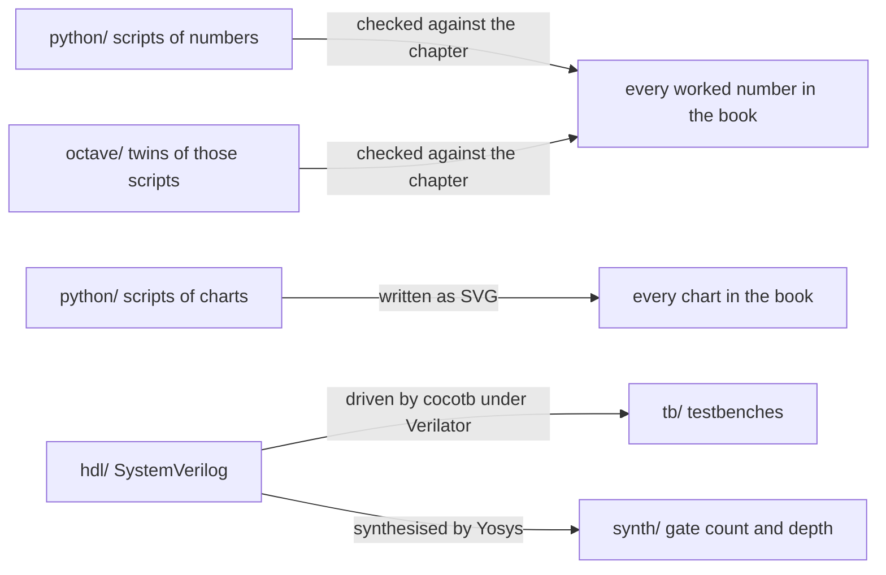

<div align="center">

<a href="https://dranirbanchakraborty.com/learn/error-correction-coding"><picture><source media="(prefers-color-scheme: dark)" srcset="https://raw.githubusercontent.com/anirbanchakraborty-dev/anirbanchakraborty-dev/output/repo-ecc-book-lab-banner-dark.svg"></picture></a>

[The book](https://dranirbanchakraborty.com/learn/error-correction-coding) · [Running it](#running-it) · [In GNU Octave](#running-it-in-gnu-octave) · [Layout](#layout) · [The parity checker](hdl/parity)

</div>

Companion repository for *Error Correction Coding*, the online book at [dranirbanchakraborty.com/learn/error-correction-coding](https://dranirbanchakraborty.com/learn/error-correction-coding). Every number the book prints and every chart it draws is computed by a program in this repository, and every hardware listing the book supplies lives here in finished form, with the testbench that exercises it.

The book does not teach SystemVerilog or cocotb, and it teaches only as much Python as reading the scripts needs. It hands over each listing complete and explains what the hardware does. For the languages themselves, the *RTL Design and Verification* book, in preparation, and the HDL material in *Computer Architecture* on the same site start from nothing.

Each kind of file feeds the book its own way.



## Running it

The chapter scripts need Python 3.10 or newer and nothing outside the standard library.

```bash
python3 python/ch01_why_codes_exist.py
```

That reproduces every worked number in Why Codes Exist, the first chapter of Part I, prints each one beside the value the chapter states, and stops with an error the moment any of them disagrees. A run that ends with `All chapter 1 numbers reproduced.` is a passing run. Script numbers count from that chapter, so they differ from the chapter numbers the website shows, and the three front-matter chapters before it have scripts named `chf1`, `chf2` and `chf3`.

```bash
python3 python/ch01_charts.py --out figures
```

That writes the chapter's two charts as SVG files into `figures/`. The book's copies are made the same way, so a chart is corrected by fixing the script and running it again, never by editing the SVG.

## Running it in GNU Octave

Every script of numbers in `python/` has a twin in `octave/` with the same name, which computes the same values in GNU Octave, prints the same lines and stops the same way when a value disagrees with the chapter. The twins need GNU Octave 7 or newer and no Octave package, and they have been run with Octave 11.3.0 on macOS. From the repository root:

```bash
octave --no-window-system --norc --quiet octave/ch01_why_codes_exist.m
```

The front-matter chapter "The Octave Route" installs Octave on macOS, Linux and Windows, teaches the parts of the language the twins use, and shows how to hand numbers between the two languages without losing a bit. Its own pair of scripts takes a `--handoff` option that runs the other language as a separate program and measures each crossing:

```bash
python3 python/chf3_ecc_octave_route.py --handoff
octave --no-window-system --norc --quiet octave/chf3_ecc_octave_route.m --handoff
```

The chart scripts have no twins, and the hardware labs stay in Python, because cocotb, which drives the simulations, is a Python library. An Octave reader runs those with Python, from Octave's `system` function or from a shell.

```bash
tools/compare-routes.sh
tools/compare-routes.sh ch05 chf2
```

That runs each chapter's Python script and its Octave twin and checks that the two print the same lines, ignoring only runs of spaces, and that both exit with status 0. It exits 0 when every chapter passes, 1 when any differs and 2 when Python or Octave is missing, and `PYTHON` and `OCTAVE` name other interpreters.

The hardware chapters also need Verilator 5.036 or newer and cocotb 2.1, and Yosys for the gate counts. The chapter "Lab: A First Hardware Checker" gives the install steps for macOS, Linux and Windows. From the repository root:

```bash
python tb/parity/run_parity.py
python synth/synth_parity.py
```

The first builds the parity bench three times under Verilator and runs its cocotb tests, and the second synthesizes the parity generator and checker with Yosys and checks their gate counts and depths against the formulas the chapter proves. Simulation output, the waveform included, lands in `tb/parity/sim_build/`, which git ignores.

## Layout

The folders arrive as the chapters need them.

- `python/` holds one script of numbers and, where a chapter has charts, one script of charts per chapter, named after the chapter.
- `octave/` holds the GNU Octave twin of each script of numbers, under the same name. `octave/common/` holds the four helpers the twins share: `half_unit`, the tolerance every check allows, `py_g` and `py_str`, which print a value the way Python does, and `PyRandom`, Python's random-number generator rewritten in Octave so that the twins draw the same random numbers.
- `tools/` holds `compare-routes.sh`, which checks that each script and its twin print the same lines.
- `hdl/` holds the SystemVerilog, one folder per design. `hdl/parity/` is the parity generator and checker of "Lab: A First Hardware Checker", built from one parameterized XOR tree, with the bench that joins them through a simulated channel.
- `tb/` holds the cocotb testbenches that drive those designs under Verilator, one folder per design, each with a runner script that builds and runs it. `tb/parity/` also holds a Surfer command file that opens the waveform with the bench's signals in view.
- `synth/` holds the open-source synthesis scripts that report each design's gate count and depth. `synth/synth_parity.py` is the one for "Lab: A First Hardware Checker".
- `formal/` will hold the properties that prove a design correct for every input rather than for the inputs a test happened to try.
- `data/` will hold the measured data sets a chapter plots, each with a note on where it came from.

## License

MIT. See [LICENSE](LICENSE).
