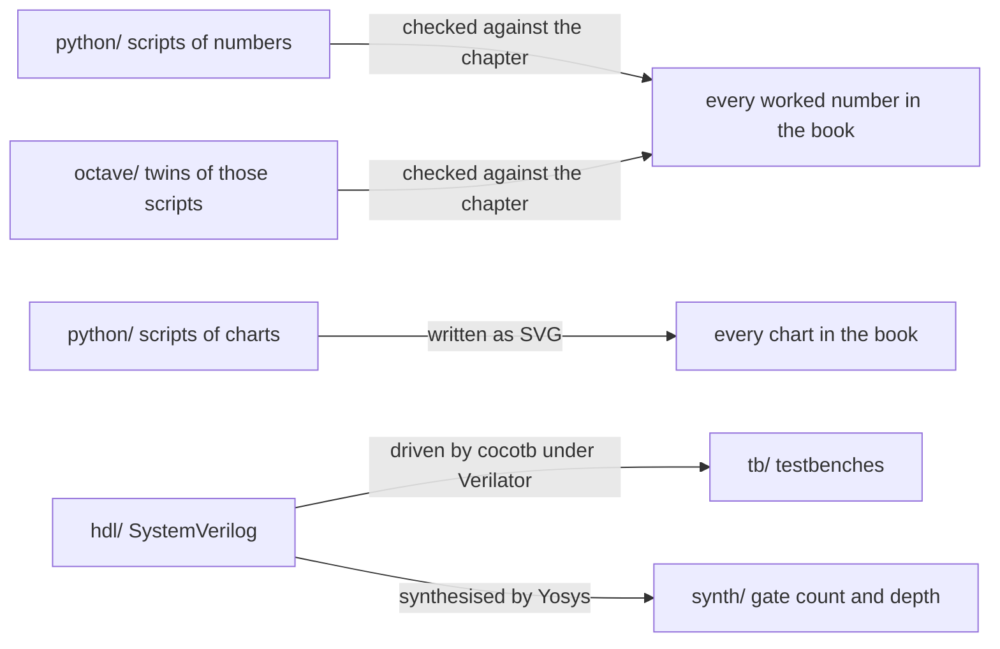

<div align="center">

<a href="https://dranirbanchakraborty.com/learn/error-correction-coding"><picture><source media="(prefers-color-scheme: dark)" srcset="https://raw.githubusercontent.com/anirbanchakraborty-dev/anirbanchakraborty-dev/output/repo-ecc-book-lab-banner-dark.svg"></picture></a>

[The book](https://dranirbanchakraborty.com/learn/error-correction-coding) · [Running it](#running-it) · [In GNU Octave](#running-it-in-gnu-octave) · [Layout](#layout) · [The parity checker](hdl/parity)

</div>

Companion repository for *Error Correction Coding*, the online book at [dranirbanchakraborty.com/learn/error-correction-coding](https://dranirbanchakraborty.com/learn/error-correction-coding). Every number the book prints and every chart it draws is computed by a program in this repository, and every hardware listing the book supplies lives here in finished form, with the testbench that exercises it.

The book does not teach SystemVerilog or cocotb, and it teaches only as much Python as reading the scripts needs. It hands over each listing complete and explains what the hardware does. For the languages themselves, the *RTL Design and Verification* book, in preparation, and the HDL material in *Computer Architecture* on the same site start from nothing.

Each kind of file feeds the book its own way.



## Running it

The chapter scripts need Python 3.10 or newer and nothing outside the standard library.

```bash
python3 python/ch01_why_codes_exist.py
```

That reproduces every worked number in Why Codes Exist, the first chapter of Part I, prints each one beside the value the chapter states, and stops with an error the moment any of them disagrees. A run that ends with `All chapter 1 numbers reproduced.` is a passing run. Script numbers count from that chapter, so they differ from the chapter numbers the website shows, and the three front-matter chapters before it have scripts named `chf1`, `chf2` and `chf3`.

```bash
python3 python/ch01_charts.py --out figures
```

That writes the chapter's two charts as SVG files into `figures/`. The book's copies are made the same way, so a chart is corrected by fixing the script and running it again, never by editing the SVG.

## Running it in GNU Octave

Every script of numbers in `python/` has a twin in `octave/` with the same name, which computes the same values in GNU Octave, prints the same lines and stops the same way when a value disagrees with the chapter. The twins need GNU Octave 7 or newer and no Octave package, and they have been run with Octave 11.3.0 on macOS. From the repository root:

```bash
octave --no-window-system --norc --quiet octave/ch01_why_codes_exist.m
```

The front-matter chapter "The Octave Route" installs Octave on macOS, Linux and Windows, teaches the parts of the language the twins use, and shows how to hand numbers between the two languages without losing a bit. Its own pair of scripts takes a `--handoff` option that runs the other language as a separate program and measures each crossing:

```bash
python3 python/chf3_ecc_octave_route.py --handoff
octave --no-window-system --norc --quiet octave/chf3_ecc_octave_route.m --handoff
```

The chart scripts have no twins, and the hardware labs stay in Python, because cocotb, which drives the simulations, is a Python library. An Octave reader runs those with Python, from Octave's `system` function or from a shell.

```bash
tools/compare-routes.sh
tools/compare-routes.sh ch05 chf2
```

That runs each chapter's Python script and its Octave twin and checks that the two print the same lines, ignoring only runs of spaces, and that both exit with status 0. It exits 0 when every chapter passes, 1 when any differs and 2 when Python or Octave is missing, and `PYTHON` and `OCTAVE` name other interpreters.

The hardware chapters also need Verilator 5.036 or newer and cocotb 2.1, and Yosys for the gate counts. The formal proofs also need SymbiYosys and a solver for it to call, z3 in the book's commands. The chapter "Setting Up the Lab Bench" gives the install steps for macOS, Linux and Windows, SymbiYosys and z3 included, and they end in a virtual environment holding cocotb. From the repository root, with that environment active, so that `python` names its interpreter:

```bash
python tb/parity/run_parity.py
python synth/synth_parity.py
python tb/secded/run_secded.py
python formal/secded/run_formal.py
```

The first builds the parity bench three times under Verilator and runs its cocotb tests, and the second synthesizes the parity generator and checker with Yosys and checks their gate counts and depths against the formulas the chapter proves. Simulation output, the waveform included, lands in `tb/parity/sim_build/`, which git ignores. The third builds the SEC-DED bench of "Verifying ECC Hardware" once for the correct decoder and once for each planted bug, and checks the cases each gets wrong against two software models. The fourth runs the SymbiYosys proofs of the same decoder and checks every verdict and every counterexample, including that each counterexample is the pair the chapter quotes. Those pairs are the ones z3 returned on the recorded run, and with `--any-counterexample` the runner accepts any pair the model agrees is wrong, as another solver build may choose. Their output lands in `tb/secded/sim_build/` and in the `secded_*` folders under `formal/secded/`, which git ignores too.

The project chapter "Project: A SEC-DED Encoder and Decoder" adds a third design, the (72,64) SEC-DED encoder and decoder a 64-bit memory port would use, and it runs from the repository root with the same virtual environment active:

```bash
python tb/secded72/check_secded72.py
python tb/secded72/run_secded72.py
python tb/secded72/run_secded72.py --flag parity
python synth/synth_secded72.py
python formal/secded72/run_formal72.py
```

The first checks that every check matrix the project uses is, column for column, the matrix the script of "SECDED and Hsiao Codes" builds, that each has minimum distance at least four, and that `hdl/secded72/secded72_pkg.sv` is exactly what `tb/secded72/gen_secded72_pkg.py` writes from the model today, so a matrix edited in one place and not the other stops the run. The second builds the bench under Verilator once for the balanced Hsiao code and once for the extended Hamming code, drives every error pattern of weight two or less onto the codeword of 1,066 data words, 2,802,514 cases for each code, and checks every case against the Python model and against the guarantee the code makes, and `--flag parity` repeats the sweep with the other form of the uncorrectable flag while `--code` picks one code, `hsiao_dictionary` and `hsiao_39_32` included. The third synthesizes the encoder, the syndrome stage and both forms of the decoder with Yosys and ABC for each code and checks every gate count and depth against `data/ch30/secded72_gates.json`, and `--write` records a new run there instead. The fourth runs nine SymbiYosys tasks, the four proofs that the Hsiao and the extended Hamming decoders meet the guarantee for all $2^{64}$ data words in both forms of the flag, two covers that show each weight of error is reachable, a deliberately narrowed assumption whose weight-2 cover must fail, and the proofs the exercises use, and it checks every verdict. The proofs run on ABC's pdr engine, which SymbiYosys starts as `yosys-abc` on an AIGER file that Yosys writes, and the covers on yosys-smtbmc with z3. Their output lands in `tb/secded72/sim_build/` and in the `secded72_*` folders under `formal/secded72/`, which git ignores.

The project chapter needs nothing beyond the earlier hardware chapters, Verilator 5.036 or newer, cocotb 2.1, Yosys with its `yosys-abc`, SymbiYosys and z3, and it was measured with Verilator 5.054, Yosys 0.71, SymbiYosys 0.71 and Z3 5.4.1, the versions "Setting Up the Lab Bench" records for 2026-11-14, with the Yosys build that `data/ch30/secded72_gates.json` names. On an installation where SymbiYosys's `yosys-witness` cannot import the Python `click` module, a failing pdr proof ends in ERROR rather than FAIL, and `run_formal72.py` reads the engine's own line to report it as FAIL.

## Layout

The folders arrive as the chapters need them.

- `python/` holds one script of numbers and, where a chapter has charts, one script of charts per chapter, named after the chapter.
- `octave/` holds the GNU Octave twin of each script of numbers, under the same name. `octave/common/` holds the four helpers the twins share: `half_unit`, the tolerance every check allows, `py_g` and `py_str`, which print a value the way Python does, and `PyRandom`, Python's random-number generator rewritten in Octave so that the twins draw the same random numbers.
- `tools/` holds `compare-routes.sh`, which checks that each script and its twin print the same lines.
- `hdl/` holds the SystemVerilog, one folder per design. `hdl/parity/` is the parity generator and checker of "Lab: A First Hardware Checker", built from one parameterized XOR tree, with the bench that joins them through a simulated channel. `hdl/secded/` is the Hsiao (13,8) SEC-DED encoder and decoder of "Verifying ECC Hardware", the decoder with a parameter that plants one of four bugs, with its bench and the wrapper that states its guarantees for a formal tool. `hdl/secded72/` is the (72,64) SEC-DED encoder and decoder of "Project: A SEC-DED Encoder and Decoder", generic over the check matrix through one `CODE` parameter, with a generated package that carries every matrix, a syndrome stage shared by the decoder, a decoder with two forms of the uncorrectable flag, a bench that joins encoder and decoder through a simulated channel, and the wrapper that states the guarantee for a formal tool.
- `tb/` holds the cocotb testbenches that drive those designs under Verilator, one folder per design, each with a runner script that builds and runs it. `tb/parity/` also holds a Surfer command file that opens the waveform with the bench's signals in view. `tb/secded/` also holds the pure-Python model of the SEC-DED code that its tests and the formal runner share. `tb/secded72/` also holds the pure-Python model of the four codes the project builds, the script that writes the SystemVerilog package from that model, and the check that ties every matrix back to "SECDED and Hsiao Codes".
- `synth/` holds the open-source synthesis scripts that report each design's gate count and depth. `synth/synth_parity.py` is the one for "Lab: A First Hardware Checker", and `synth/synth_secded72.py` the one for "Project: A SEC-DED Encoder and Decoder", counting two-input gates and logic levels in the netlist ABC maps for each code.
- `formal/` holds the properties that prove a design correct for every input rather than for the inputs a test happened to try, one folder per design. `formal/secded/` holds the SymbiYosys tasks for the SEC-DED decoder of "Verifying ECC Hardware" and a runner that checks each verdict. `formal/secded72/` holds the SymbiYosys tasks for the (72,64) decoders of "Project: A SEC-DED Encoder and Decoder" and a runner that checks each verdict.
- `data/` holds the measured data sets a chapter uses, each with a note on where it came from. `data/ch30/` holds the Yosys gate counts and depths of the project chapter's encoders and decoders.

## License

MIT. See [LICENSE](LICENSE).
